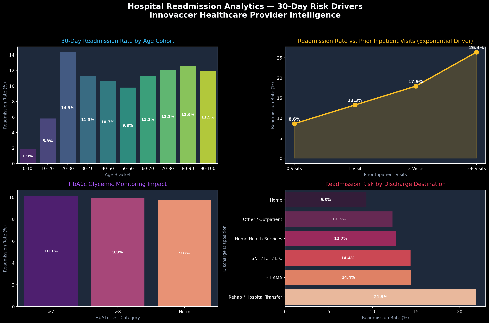

# Hospital Readmission Analytics (SQL + Python + Tableau)



## Overview
This repository contains an end-to-end data analytics project analyzing **30-day hospital readmissions** using the **UCI Diabetes 130-US Hospitals dataset (1999–2008)** (~100,000 encounters across 130 US hospitals). 

In value-based healthcare, 30-day readmission is a core performance metric. Under the CMS **Hospital Readmissions Reduction Program (HRRP)**, hospitals face financial penalties of up to 3% of total Medicare reimbursements if their readmission rates exceed national benchmarks. This project focuses on identifying high-risk patient cohorts, analyzing clinical patterns, and structuring data for executive reporting.

---

## 🔗 Live Dashboards & Links
- **Tableau Public Interactive Dashboard**: [https://public.tableau.com/app/profile/gaurish.2703/viz/HospitalReadmissionAnalytics_17909067940160/Story1](https://public.tableau.com/app/profile/gaurish.2703/viz/HospitalReadmissionAnalytics_17909067940160/Story1)
- **Local Glassmorphism HTML Dashboard**: [`dashboard/index.html`](dashboard/index.html)
- **Tableau Setup Guide**: [`dashboard/TABLEAU_GUIDE.md`](dashboard/TABLEAU_GUIDE.md)

---

## Tech Stack & Data Architecture
- **Data Engineering**: Python (`pandas`, `numpy`)
- **Exploratory Data Analysis**: Jupyter Notebook ([`notebooks/01_hospital_readmission_cleaning.ipynb`](notebooks/01_hospital_readmission_cleaning.ipynb))
- **SQL Analysis**: Standard ANSI SQL (tested on SQLite via `sqlite3`, fully compatible with MySQL 8.0+ and PostgreSQL)
- **Visualizations**: Tableau Public, HTML5/CSS3 Glassmorphism UI, Chart.js

---

## Data Cleaning & Audit Summary

The raw dataset (`diabetic_data.csv`) contains noise common in Electronic Health Records (EHR). The cleaning script ([`scripts/01_data_cleaning.py`](scripts/01_data_cleaning.py)) applies the following steps:

1. **Missing Value Handling**: Converted missing placeholder `'?'` to `NaN`. Dropped columns with prohibitive missingness (`weight` ~97% missing, `payer_code` ~40%, `medical_specialty` ~49%).
2. **Exclusion Criteria**: Excluded **2,423 encounters** where patients expired or entered hospice care (`discharge_disposition_id` in `11, 13, 14, 19, 20, 21`), as 30-day readmission is not possible for these patients.
3. **Cohort Structure (Encounter vs First-Visit)**:
   - **Encounter-Level Cohort (`99,343` rows)**: Primary dataset used for workload & readmission event modeling.
   - **First-Visit Patient Cohort (`69,990` rows)**: Deduplicated dataset isolating each patient's index visit (`patient_nbr`) to eliminate repeat-patient bias during validation.

### Data Cleaning Log
| Pipeline Step | Description | Records Removed | Cohort Count |
| :--- | :--- | :---: | :---: |
| **Initial Raw Dataset** | Total encounters loaded | — | **101,766** |
| **Exclusion Filter** | Deceased and hospice care encounters removed | -2,423 | **99,343** |
| **Deduplicated Cohort** | Secondary repeat visits removed for patient-level check | -29,353 | **69,990** |

---

## SQL Queries & Data Slicing

The SQL query file ([`sql/02_readmission_analysis.sql`](sql/02_readmission_analysis.sql)) contains 8 analytical queries. Key query patterns include:

### 1. Window Function: Patient Visit Sequencing
Ranks encounters chronologically per patient using `ROW_NUMBER() OVER` to track patient history sequence.

```sql
SELECT 
    encounter_id,
    patient_nbr,
    age_clean,
    number_inpatient,
    readmitted_30day,
    ROW_NUMBER() OVER (
        PARTITION BY patient_nbr 
        ORDER BY encounter_id ASC
    ) AS patient_visit_sequence_num,
    COUNT(*) OVER (
        PARTITION BY patient_nbr
    ) AS total_patient_encounters
FROM cleaned_patient_encounters;
```

### 2. Common Table Expression (CTE): Cohort Risk Benchmarking
Uses a CTE to group encounters by prior inpatient history (2+ visits vs 0-1 visits) and compare risk rates.

```sql
WITH patient_cohorts AS (
    SELECT 
        encounter_id,
        patient_nbr,
        readmitted_30day,
        number_inpatient,
        CASE 
            WHEN number_inpatient >= 2 THEN '2+ Prior Inpatient Visits Cohort'
            ELSE 'Baseline Cohort (0-1 Prior Visits)'
        END AS risk_cohort
    FROM cleaned_patient_encounters
),
cohort_metrics AS (
    SELECT 
        risk_cohort,
        COUNT(*) AS total_encounters,
        SUM(readmitted_30day) AS readmissions_30day,
        AVG(readmitted_30day) AS readmission_rate
    FROM patient_cohorts
    GROUP BY risk_cohort
),
baseline AS (
    SELECT readmission_rate AS baseline_rate 
    FROM cohort_metrics 
    WHERE risk_cohort = 'Baseline Cohort (0-1 Prior Visits)'
)
SELECT 
    cm.risk_cohort,
    cm.total_encounters,
    cm.readmissions_30day,
    ROUND(cm.readmission_rate * 100.0, 2) AS readmission_rate_pct,
    ROUND(cm.readmission_rate / b.baseline_rate, 2) AS risk_multiplier_vs_baseline
FROM cohort_metrics cm
CROSS JOIN baseline b;
```

---

## Key Analytics Takeaways

### 1. Prior Inpatient Visits Pattern (2.3x Baseline Risk)
- **Data**: Patients with 0 prior inpatient visits had an **8.59%** readmission rate (5,690 / 66,245). Rates increased with prior visits: 1 visit (**13.25%**), 2 visits (**17.93%**), and 3+ visits (**26.40%**).
- **Combined 2+ Visits Metric**: The 2+ prior visits cohort accounted for **14,114 encounters** and **3,108 readmissions**, yielding a **22.02% readmission rate** (`3,108 / 14,114`).
- **Takeaway**: Observed readmission rates in the 2+ prior visits cohort were **2.29x (2.3x)** the baseline rate of patients with 0-1 prior visits (9.63%).
- **Repeat-Patient Note**: Per-encounter rates include repeat visits by frequent patients. The deduplicated 69,990 first-visit cohort confirmed that prior inpatient history remains a strong predictor even when evaluating index visits alone.

### 2. HbA1c Glycemic Monitoring Association
- **Data**: **83.05% of encounters (82,509 / 99,343)** had no HbA1c test recorded during admission. Encounters where HbA1c was tested showed lower observed readmission rates (**9.77%–10.15%**).
- **Takeaway (Observational Wording)**: Because this is observational EHR data, testing status is associated with—rather than proven to cause—lower readmission rates. Tested patients **had lower observed readmission rates** than unmonitored patients, highlighting glycemic monitoring as an indicator of comprehensive inpatient care.

### 3. Care Setting & Discharge Pattern
- **Data**: Discharges to **Rehab / Hospital Transfer (21.88%)** and **Skilled Nursing Facilities / SNFs (14.36%)** showed higher observed rates than discharges directly home (**9.30%**).
- **Takeaway**: Transfers to post-acute facilities exhibited higher observed readmission rates, pointing to complex care transitions.

---

## Repository Structure
```
Hospital Readmission Analytics/
├── data/
│   ├── raw/                           # Raw UCI dataset (diabetic_data.csv)
│   ├── cleaned_diabetic_data.csv      # Primary encounter dataset (99,343 rows)
│   ├── cleaned_patient_first_visits.csv# Deduplicated first-visit cohort (69,990 rows)
│   └── cleaning_audit_log.txt         # Audit trail text log
├── scripts/
│   ├── 00_download_data.py            # UCI dataset downloader
│   ├── 01_data_cleaning.py            # Data cleaning & feature engineering script
│   ├── 02_execute_sql_queries.py      # SQLite SQL runner and query verifier
│   └── generate_charts.py             # Visual dashboard generator
├── notebooks/
│   └── 01_hospital_readmission_cleaning.ipynb # Interactive Jupyter cleaning notebook
├── sql/
│   ├── 01_schema_and_import.sql       # DDL schema definition
│   └── 02_readmission_analysis.sql    # 8 Analytical SQL queries (Window functions + CTEs)
├── dashboard/
│   ├── index.html                     # HTML5 Dashboard Interface
│   ├── styles.css                     # CSS Design System
│   ├── app.js                         # Chart.js visual rendering & filter logic
│   └── TABLEAU_GUIDE.md               # Tableau Public guide
├── assets/
│   └── dashboard_screenshot.png       # Dashboard screenshot asset
├── insights/
│   └── executive_insights.md          # Analytical summary report
└── README.md
```

---

## Reproduction Steps
1. **Clone the Repository**:
   ```bash
   git clone https://github.com/gaurish1811/Hospital-Readmission-Analytics.git
   cd Hospital-Readmission-Analytics
   ```
2. **Run Pipeline**:
   ```bash
   python scripts/00_download_data.py
   python scripts/01_data_cleaning.py
   python scripts/02_execute_sql_queries.py
   ```
3. **Open Dashboard**:
   Open `dashboard/index.html` in any web browser.
